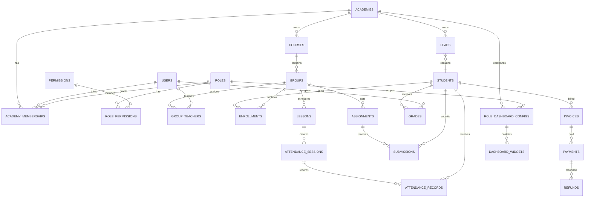

# SFERA CRM backend arxitekturasi

## 1. Rollar

| Rol | Scope | Asosiy vazifa |
|---|---|---|
| Super Admin | Barcha akademiyalar | Tizim, rollar, permission va xavfsizlik |
| Admin | Akademiya | Foydalanuvchilar, kurslar, guruhlar va akademiya sozlamalari |
| Manager | Akademiya | Lead, o‘quvchi, guruh, jadval va operatsion nazorat |
| Teacher | Biriktirilgan guruhlar | Dars, davomat, topshiriq va baholar |
| Finance | Akademiya | Invoice, payment, qarzdorlik va moliyaviy hisobot |
| Student | O‘z profili | O‘z darslari, davomat, baho va to‘lovlarini ko‘rish |

JWT autentifikatsiya hozirgi CRM’da **Clerk access JWT** orqali ishlaydi. `ClerkAuthGuard` tokenni tekshiradi, foydalanuvchini PostgreSQL’dan topadi, aktiv akademiya membership’ini va role permission’larini yuklaydi. `@RequirePermission()` va `@RolesAllowed()` metadata’lari endi guard pipeline’da real enforce qilinadi.

Development uchun test tokenlar faqat production bo‘lmaganda ishlaydi:

```http
Authorization: Bearer test-token-manager
Authorization: Bearer test-token-teacher
```

Production’da `ALLOW_TEST_AUTH_TOKENS=false` bo‘lishi kerak.

## 2. PostgreSQL jadvallari va aloqalar

### Tenant va identity

- `academies` — akademiya/filial.
- `users` — Clerk identity va profil.
- `roles` — tizim rollari.
- `permissions` — granular permission code’lar.
- `role_permissions` — role ↔ permission many-to-many.
- `academy_memberships` — user ↔ academy ↔ role; barcha akademiya query’larining scope’i.
- `user_roles` — system-wide role grant, masalan Super Admin.

### Ta’lim

- `courses` — akademiyaga tegishli kurslar.
- `groups` — kurs guruhlari.
- `group_teachers` — group ↔ teacher many-to-many.
- `students` — o‘quvchi profili.
- `enrollments` — student ↔ group many-to-many.
- `teachers` — teacher profile.
- `schedules` — takrorlanuvchi haftalik dars slotlari.
- `lessons` — aniq sanaga tegishli dars.

### Davomat va akademik natija

- `attendance_sessions` — group/lesson bo‘yicha davomat sessiyasi.
- `attendance_records` — session ↔ student status: `present`, `absent`, `late`, `excused`.
- `assignments` — teacher/group topshirig‘i.
- `submissions` — student topshirig‘i.
- `grades` — student/group/teacher bahosi.
- `grade_history` — baho o‘zgarishlari auditi.

### CRM va finance

- `leads` — ariza/lead pipeline.
- `lead_events` — lead status, call, note va trial tarixlari.
- `invoices` — student invoice.
- `invoice_items` — invoice tarkibi.
- `payments` — to‘lovlar va idempotency key.
- `payment_allocations` — payment ↔ invoice taqsimoti.
- `refunds` — refund va tasdiqlovchi.
- `debts` — qarzdorlik holati.
- `receipts` — payment receipt.
- `invoice_counters` — akademiya bo‘yicha atomic invoice numbering.

### Platforma

- `audit_logs` — kim, qachon, nimani o‘zgartirgani.
- `notifications` — user notification.
- `notification_preferences` — in-app/email/SMS preference.
- `files` — academy fayllari va entity attachment’lar.

### Admin va Manager dashboard konfiguratsiyasi

- `role_dashboard_configs` — academy + role bo‘yicha dashboard konfiguratsiyasi. Hozir `Admin/admin` va `Manager/manager` konfiguratsiyalari seed qilinadi; theme, refresh interval, title va description shu yerda saqlanadi.
- `dashboard_widgets` — har bir dashboarddagi widgetlar tartibi, turi, label’i, yoqilgan/o‘chirilgan holati va JSON config’i.

Relation: `academies 1—N role_dashboard_configs`, `roles 1—N role_dashboard_configs`, `role_dashboard_configs 1—N dashboard_widgets`.

### Asosiy relation diagrammasi



## 3. API endpointlar

Base URL: `/api`.

### Manager workspace

| Method | Endpoint | Permission |
|---|---|---|
| GET | `/manager/dashboard` | `dashboard.read` |
| GET | `/manager/activities` | `audit_logs.read` |
| GET | `/manager/groups/statistics` | `groups.read` |
| GET | `/manager/teachers/performance` | `teachers.read` |
| GET | `/manager/financial/overview` | `finance.reports.read` |

Manager dashboard endpointlari endi hardcoded demo raqamlarni emas, `academyId` bo‘yicha PostgreSQL aggregation’larni qaytaradi.

### Teacher workspace

| Method | Endpoint | Permission |
|---|---|---|
| GET | `/teacher/dashboard` | `teacher.workspace` |
| GET | `/teacher/groups` | `teacher.workspace` |
| GET | `/teacher/schedule?from=&to=` | `teacher.workspace` |
| GET | `/teacher/lessons/today` | `teacher.workspace` |
| GET | `/teacher/lessons/:lessonId/attendance` | `teacher.workspace` |
| PUT | `/teacher/lessons/:lessonId/attendance` | `teacher.workspace` |
| GET | `/teacher/students` | `teacher.workspace` |
| GET | `/teacher/assignments` | `teacher.workspace` |
| POST | `/teacher/assignments` | `teacher.workspace` |
| PUT | `/teacher/assignments/:assignmentId` | `teacher.workspace` |
| DELETE | `/teacher/assignments/:assignmentId` | `teacher.workspace` |
| GET | `/teacher/grades?groupId=` | `teacher.workspace` |
| PUT | `/teacher/grades` | `teacher.workspace` |
| GET | `/teacher/me` | `teacher.workspace` |
| PUT | `/teacher/me` | `teacher.workspace` |

### Shared CRUD workspace’lar

- `/api/v1/auth/me`
- `/api/v1/academies`
- `/api/v1/courses`
- `/api/v1/groups`
- `/api/v1/students`
- `/api/v1/enrollments`
- `/api/v1/attendance`
- `/api/v1/grades`
- `/api/v1/leads`
- `/api/v1/finance/*`
- `/api/v1/reports/*`
- `/api/v1/audit-logs`

## 4. Permission prinsipi

1. JWT signature/expiry tekshiriladi.
2. User `users` jadvalidan topiladi.
3. User’ning aktiv `academy_memberships` yozuvi tanlanadi.
4. Membership roli uchun `role_permissions` orqali permission’lar olinadi.
5. `Super Admin` bundan mustasno barcha endpointlarga ega.
6. Qolgan rollarda endpoint metadata’sidagi permission bo‘lmasa `403 Forbidden` qaytariladi.
7. Har bir query `academyId` bilan scope qilinadi; Teacher workspace esa teacher/group biriktirilishiga scope qilinadi.

## 5. Ishga tushirish

```bash
pnpm db:migrate
pnpm db:seed
pnpm api:dev
```

API Swagger: `/api/docs`.
